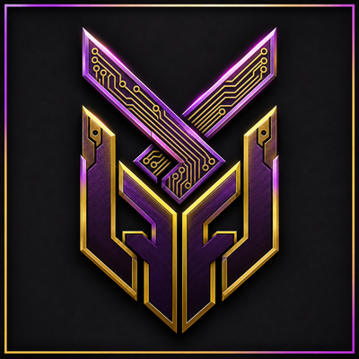

#  RGX | Profession Leveling Guide

##  RGX Mods - [RealmGX](https://realmgx.com) Community Project

**"The profession leveling bible." - Now in World of Warcraft!**

The profession leveling bible for **WoW Forever**. Open the book, pick a profession, and see exactly what to craft or gather next, how many of it, what it takes, and where to get it.

 **The Kiwi Says:** *"Open the book, follow the page, watch the bars fill. Bwwiiiee."*

## What you get

- **The book.** One window with a tile for each of the twelve professions, showing your live skill and a progress bar. Click a tile to open its 1-300 leveling path.
- **Next up, at a glance.** The step you are on shows the number of crafts (or points) still to go, the instruction in one line, when the recipe stops giving skill-ups, and a progress bar through the step.
- **Materials with live counts.** Every reagent for the step with what you have against what you need, an item tooltip on hover, and a total for everything left to reach the cap.
- **Materials to Max.** A compact overlay with a tab for each rank still to come, a totals bar and a Material / Have / Need list. Drag the corner to resize it, hold Ctrl and scroll to scale it, and use the lock to keep it open when you press Escape.
- **Where to get it.** The nearest trainer or vendor for your faction with its zone and coordinates. Click it to put a waypoint on your map.
- **Step list and tooltips.** Every step is in the list with its skill range and colour; hover for the recipe tooltip and the materials it needs.
- **Settings.** The gear in the book's header opens a small window: minimap icon on/off, open the guide with a profession window, and select recipes when you click them.
- **Minimap button.** Left-click opens the book, drag moves it, right-click opens the settings, Ctrl+right-click hides it.
- **Live trade-window guide.** When a profession window is open, the step-by-step guide appears beside it.

## Installation

1. Install [RGX-Framework](https://github.com/RGXMods/RGX-Framework) **2.15.2 or later** (required).
2. Copy the `RGXProfessions` folder into your WoW Forever `Interface\AddOns` folder.
3. Restart the client (or `/reload`) and enable both addons.

## Commands

| Command | Effect |
|---|---|
| `/prof` | Open or close the book |
| `/prof book` | Open the book |
| `/prof show` | Open the trade-window guide, or the profession menu if no window is open |
| `/prof show <profession>` | Open the guide for a profession (partial names work) |
| `/prof preview <profession> <skill>` | Preview the steps for a skill level |
| `/prof tips <profession>` | Print what Forever changed, tips and kit for a profession |
| `/prof settings` | Open the settings window |
| `/prof icon on/off` | Show or hide the minimap button |

## Language support

RGXProfessions is localized for all twelve WoW client locales: enUS (base), deDE, esES, esMX, frFR, itIT, koKR, ptBR, ptPT, ruRU, zhCN and zhTW. Every user-visible string comes from `Constants/Localization.lua`, selected by the client's locale with automatic fallback to English.

## Compatibility

- WoW Forever (Interface 16001).
- Requires RGX-Framework 2.15.2 or later. RGXProfessions draws nothing itself: its windows, cards, headers and buttons come from the framework's **RGX Material Round** interface style, in RGXProfessions' own colours, and no other addon's theme is touched.
- The bundled data also contains Cataclysm and Mists paths for future flavor builds; the client picks its data set.

## Data

All twelve professions carry the current Forever data. The eight crafting professions have full 1-300 routes with expected craft counts, skill-up colours and per-craft reagents; Fishing, Herbalism, Mining and Skinning have gathering brackets with Alliance and Horde zones. Re-run `tools/gen-forever-guides.py --fetch` to refresh it.

## Support

Part of the [RealmGX](https://realmgx.com) community project. Join us at discord.gg/N7kdKAHVVF.

- **Buy Me a Coffee:** [Donate](https://www.buymeacoffee.com/donniedice)
- **Donate via CashApp:** [Donate](https://bit.ly/3fyxxSU)
- **Star on GitHub:** [RGX | Professions](https://github.com/RGXMods/RGXProfessions)

## Credits

- **PLG (Profession Leveling Guide)** by LirameiRav, updated from the original Retail version by Keg, is the addon this one grew from.
- Classic, Cataclysm and Mists guides from wow-professions.com.
- WoW Forever 1-300 routes, reagents, notes and tips from [WoWSoD Pro](https://wowsod.pro/wow-forever/professions/leveling) (Wowhead Forever data, final pre-launch skill-up colours).
- Rebranded and extended by DonnieDice for RealmGX.

---

**Made with by the** RealmGX Community
**Lead Developer:** [DonnieDice](https://github.com/donniedice)

 **The Kiwi Says:** *"Level up your professions the fast way. Bwwiiiee."*

[Join our Discord Community](https://discord.gg/N7kdKAHVVF) | [Star us on GitHub](https://github.com/RGXMods/RGXProfessions) | [Support Development](https://www.buymeacoffee.com/donniedice)

** RGX Mods - Powered by  RealmGX Community**
